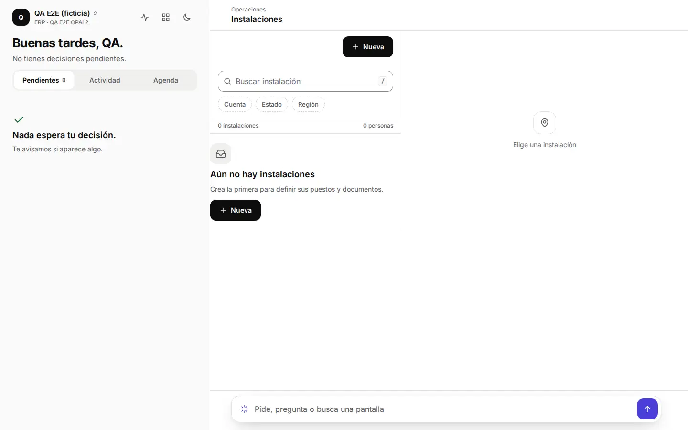
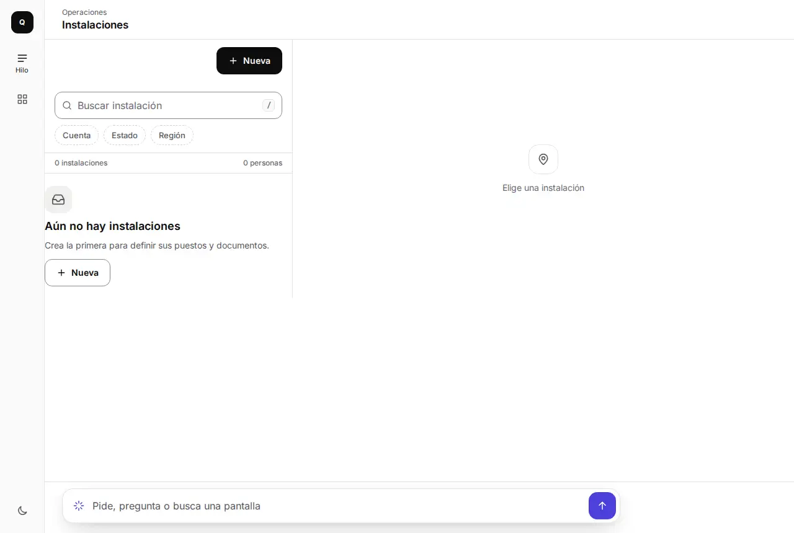
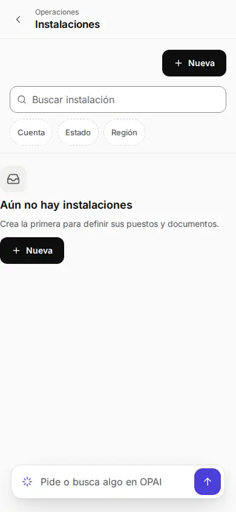
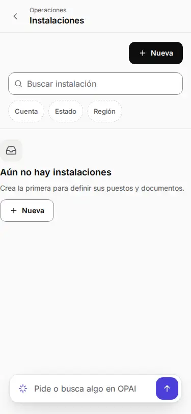
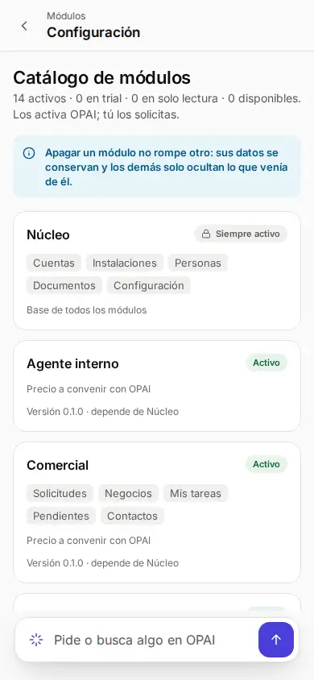
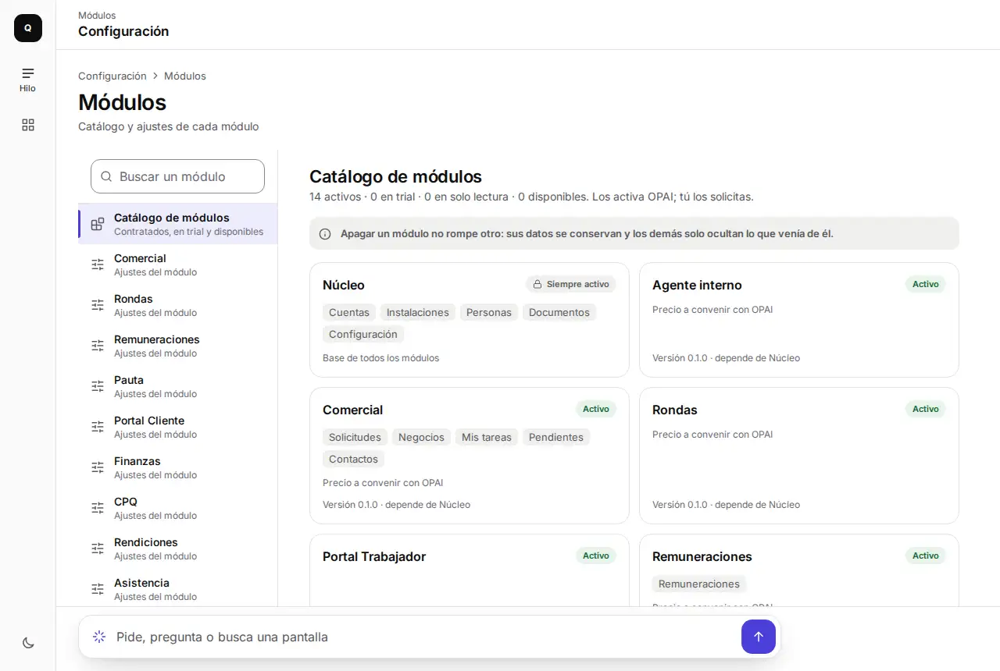
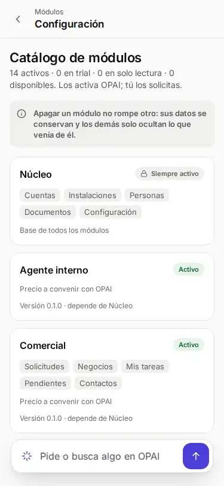

# CAR-360 y CAR-361 · antes y después

Marco Hilo, empresa ficticia `qa-e2e`. «Antes»: auditoría del 12-nov-2026 (1440 y 390 px). «Después»: `preview-e2e` del PR #598 (1280 y 375 px).

| | Antes | Después |
|---|---|---|
| Instalaciones vacía, escritorio |  |  |
| Instalaciones vacía, teléfono |  |  |
| Aviso de Módulos |  |   |
